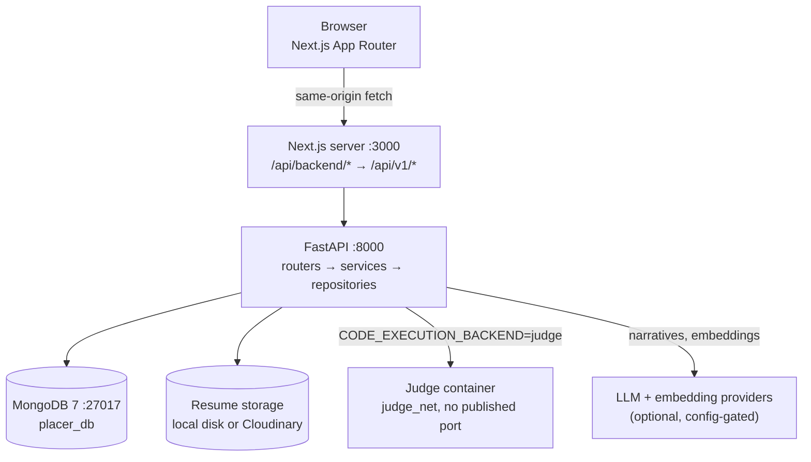

# PLACER — Detailed Feature & Architecture Reference

> **Canonical quickstart:** [`README.md`](./README.md). This file is the longer
> reference for features, architecture, the AI pipeline, and the API surface.
> For end-to-end behaviour see [`docs/SYSTEM_FLOW.md`](./docs/SYSTEM_FLOW.md);
> for page-by-page data flow and the full API reference see
> [`docs/PLACER_SYSTEM_DESIGN_AND_DATA_FLOW.md`](./docs/PLACER_SYSTEM_DESIGN_AND_DATA_FLOW.md).

**PLACER** (**P**lacement & **L**earning **A**ssistance with **C**andidate
**E**valuation & **R**anking) is a full-stack campus recruitment and placement
platform for Students, TPOs, and Admins.

| Layer | Technology |
|---|---|
| Frontend | Next.js 15.5 (App Router), React 19, TypeScript, Tailwind, Recharts, TanStack Query |
| Backend | FastAPI (Python 3.12), Pydantic v2, Motor async MongoDB driver |
| Database | MongoDB 7 (`placer_db`, 24 collections) |
| Auth | JWT access token (memory) + rotating httpOnly refresh cookie, RBAC, optional Google Sign-In |
| Matching | Fine-tuned bi-encoder + cross-encoder + Platt calibration |
| Parsing | PyMuPDF, pdfplumber, PaddleOCR PP-OCRv4, spaCy, LLM skill extraction |
| LLM / RAG | OpenAI-compatible primary + fallback client; MongoDB cosine vector store |
| Code execution | Python/JavaScript subprocess runner, local or isolated judge container |
| Tests | pytest + pytest-asyncio + mongomock-motor — **331 tests** |

---

## 1. Role capabilities

### Student portal
- **Profile:** academic details, links, skills, achievements, certificates,
  completeness percentage.
- **Resume:** PDF upload, SHA-256 dedupe, version history, one active version,
  synchronous parsing, OCR fallback, parsed preview, download, reparse.
- **Autofill:** reviewable suggestion built from the parsed resume; applying it
  fills only empty/derived profile fields.
- **Drives:** browse open drives, server-side eligibility (CGPA, department,
  batch year), match score with matched/missing skills, apply, track status.
- **Assessments:** adaptive practice papers and standardized drive papers,
  timers, anti-cheat events, coding questions with visible samples, results.
- **Learning:** skill mastery and insights narrative in the UI; per-attempt gap
  analysis is API-only.

### TPO portal
- **Drives:** create/edit/clone, open/close, JD, required skills, eligibility,
  deadline, linked standardized assessment, applicant list.
- **Screening:** recompute match scores, reconcile assessment pass/fail,
  recommended shortlist, bulk/individual shortlist/reject, CSV export.
- **Analytics:** application status, drive funnels, department/company views,
  participation, assessment ranking.
- **Market Insights:** demand by skill, trending/declining momentum, filters,
  comparison, import-run provenance.
- **Skill Gaps:** student evidence (assessment-demonstrated + self-reported) vs
  market demand, filterable by department/batch/company/drive.

### Admin portal
- **Question bank:** CRUD, categories, difficulty/type filters, coding sample
  tests, bulk Excel/CSV preview + commit, Excel/CSV export.
- **Assessments:** templates and presets, standardized placement-paper
  generation, revision, participation, platform-wide listing.
- **Applications workspace:** cross-drive application records and analytics.
- **Platform:** admin analytics and activity summary, LLM/embedding
  observability endpoints, RAG knowledge-store ingest/delete/stats endpoints.
- **Bootstrap:** admin accounts are created only through
  `backend/scripts/create_admin.py`; there is no public admin registration.

---

## 2. System architecture



**Request path:** axios wrapper (`lib/api-client.ts`) → Next.js rewrite →
`RequestIdMiddleware` → `CORSMiddleware` → `get_current_user` /
`require_role(...)` → router validation → service → repository → MongoDB.
A `401` triggers one refresh-and-retry via `/auth/refresh`.

**Design boundaries:**
- Routers stay thin; business logic lives in `app/services/`.
- One repository per collection; services never touch Motor directly.
- LLMs narrate already-computed numbers and never invent scores.
- AI failures fail soft: deterministic fallback data or a clear `503`.

---

## 3. Resume and AI pipeline

```text
PDF bytes
  → size cap, %PDF signature, SHA-256 dedupe
  → storage (local / Cloudinary)
  → PyMuPDF text extraction
  → pdfplumber fallback
  → OCR (PaddleOCR PP-OCRv4) when text is short/noisy
  → regex structural parse (contact, education, experience, projects, skills)
  → LLM skill extraction (regex fallback)
  → profile autofill suggestion
  → cached bi-encoder embedding on the resume
  → drive match scoring
  → grounded explanation / insights / gap analysis
```

### Text extraction and OCR
- PyMuPDF is primary; pdfplumber is the fallback.
- OCR triggers when extracted characters are below
  `OCR_TRIGGER_MIN_CHARS` (50) or the alphanumeric ratio is below
  `OCR_MIN_ALPHANUMERIC_RATIO` (0.5).
- Pages render at `OCR_RENDER_DPI` (150); OCR is disabled with
  `OCR_ENABLED=false`.
- OCR engine is a lazy singleton, so normal digital resumes do not pay the
  startup/memory cost.

### Skill extraction
- A 135-skill canonical taxonomy with 235 aliases is shared by resumes, drives,
  matching, and analytics (`backend/app/core/skill_taxonomy.py`).
- The LLM extractor uses a constrained vocabulary; unknown phrases are queued in
  `unmapped_skill_suggestions` for future review.
- If the LLM is unavailable, regex skills are returned rather than an empty set.

### Matching
Artifacts:
- `bi_encoder/` — fine-tuned `all-MiniLM-L6-v2`
- `cross_encoder/` — fine-tuned `cross-encoder/stsb-roberta-base`
- `calibrator.pkl` — sklearn `LogisticRegression` (Platt scaling)

Pipeline: embed → cosine retrieval (`DEFAULT_RETRIEVER_POOL = 100`) →
cross-encoder rerank → sigmoid → Platt calibration → hybrid score.

```text
skills_score     = |resume_skills ∩ jd_required_skills| / max(1, |jd_required_skills|)
experience_score = clamp(resume_years / jd_years, 0, 1)      # 1.0 if jd_years = 0
assessment_term  = assessment_pct / 100                       # 1.0 if not required/unscored
final_score      = 0.40·semantic + 0.30·skills + 0.20·experience + 0.10·assessment
```

Embeddings are cached as `resumes.resume_embedding` and
`placement_drives.jd_embedding`. Drive edits invalidate the JD embedding;
re-parsing a resume recomputes its embedding. Missing weights return `503`
rather than crashing the app.

### LLM and RAG
- One client interface with primary + fallback providers (NVIDIA NIM,
  OpenRouter, Gemini, or local Ollama).
- Retries only on transient failures (`429`, `5xx`, connection, timeout), with
  exponential backoff; `4xx` fails immediately.
- Grounded services:
  - `GET /applications/{id}/explanation`
  - `GET /drives/{id}/match-explanation`
  - `GET /insights/me`
  - `GET /assessments/attempts/{id}/gap-analysis`
- Knowledge chunks live in `knowledge_chunks`; cosine similarity is computed in
  Python (`KNOWLEDGE_STORE_BACKEND=mongodb_cosine`).
- Metrics are exposed at `GET /admin/observability/llm`.

---

## 4. Assessment and grading

### Creation paths
| Path | Who | Endpoint | Format |
|---|---|---|---|
| Adaptive paper | Admin | `POST /assessments` | `adaptive` |
| Standardized drive paper | Admin | `POST /assessments/placement/generate` | `standardized` |
| Template-derived | Admin | `/assessments/templates/*` then placement generation | `standardized` |

Standardized placement papers use five sections (Quantitative Aptitude, Logical
Reasoning, Verbal Ability, Technical Knowledge, Coding/Problem Solving),
20 questions, a 6/10/4 easy/medium/hard quota, and 1/3/5 marks per difficulty.
Generation is deterministic and returns `422` with explicit deficits rather than
inventing questions.

### Attempt lifecycle
1. `POST /assessments/{id}/start` validates publication, retake policy, and
   assessment type; creates an attempt with a session token.
2. Questions are delivered one at a time; answers and violations are persisted.
3. `POST /assessments/attempts/{id}/finish` grades answers, updates
   `knowledge_states`, and sets `status=submitted`.
4. `GET /assessments/attempts/{id}/results` returns the breakdown.

### Grading
- MCQ/true-false: exact match; multiple-select: all-or-nothing.
- Coding: all test cases must pass, executed by the runner/judge.
- Descriptive: stored ungraded for manual review; no automatic free-text grader.
- Negative marking applies only to standardized assessments and only to wrong
  auto-gradable answers.

### Anti-cheat and proctoring
- Per-attempt session token, server-side timer, auto-submit on expiry.
- MCQ options randomized per delivery; grading uses option values.
- Violation events: fullscreen exit, tab switch, clipboard, DevTools.
- Configurable violation threshold triggers auto-submission.
- IP and fingerprint are stored for audit; they are not continuously compared.
- Fullscreen enforcement is a client-side control, not a backend guarantee.

### Code judge
- `execute_code(language, code, test_cases, only_visible=False)` is the only
  public interface.
- `CODE_EXECUTION_BACKEND=local` runs a subprocess in the backend host (dev).
- `CODE_EXECUTION_BACKEND=judge` POSTs to the isolated judge, which runs
  read-only, non-root, with dropped capabilities, 1 CPU, 256 MB, 128 PIDs, and
  a 64 MB `/tmp` tmpfs.
- The judge grades hidden tests but only returns input/expected/actual for
  visible samples. Reference solutions are never stored in MongoDB.

---

## 5. Data model summary

24 collections in `placer_db`. Key relationships:

```text
users 1──1 students | tpos | admins          (by user_id)
students 1──* resumes                         (by student profile _id)
students 1──* applications                    (by student profile _id)
placement_drives 1──* applications             (by drive_id)
placement_drives *──1 companies                (by company_id)
assessments 1──* assessment_attempts           (by assessment_id)
students 1──* knowledge_states                 (by student_id, skill_tag)
```

Collections: `users`, `refresh_tokens`, `password_reset_tokens`, `students`,
`tpos`, `admins`, `resumes`, `placement_drives`, `companies`, `applications`,
`question_categories`, `questions`, `assessments`, `assessment_templates`,
`assessment_attempts`, `knowledge_states`, `activity_logs`, `notifications`
(index-only/unused), `unmapped_skill_suggestions`, `knowledge_chunks`,
`insights_narrative_cache`, `job_market_postings`, `market_skill_catalog`,
`market_import_runs`.

**Critical ID rule:** `users._id` is the auth identity. Operational records use
the profile `_id` (`students._id`, `tpos._id`, `admins._id`), resolved through
`StudentRepository.get_by_user_id()`. Mixing them causes “not found” bugs.

Seeded documents carry `data_origin` and `is_synthetic` for internal audit;
these are not shown as user-facing demo labels.

---

## 6. API surface (summary)

All routes are under `/api/v1` unless noted. The full table is in
`docs/PLACER_SYSTEM_DESIGN_AND_DATA_FLOW.md` §11.

| Area | Prefix | Highlights |
|---|---|---|
| Health | `/health` | `GET /health` (also root alias) |
| Auth | `/auth` | register student/TPO, login, Google, refresh, logout, forgot/reset, me |
| Students | `/students` | get/update own profile |
| Resumes | `/resumes` | upload, history, detail, download, reparse, autofill suggestion/apply |
| Drives | `/drives` | CRUD, mine, clone, apply, applications, screening, recommended shortlist, bulk status, export |
| Questions | `/questions` | categories, CRUD, stats, import preview/commit/error report, exports |
| Assessments | `/assessments` | templates, placement generate/revise/participation, start, questions, answer, finish, run-code, violation, results, knowledge states, review/grade |
| Analytics | `/analytics` | TPO, student, application analytics/records, drive ranking/applicants/participants, skill gaps, admin, activity, admin applications |
| Market | `/analytics/tpo/market` | market, filters, comparison |
| Matching | `/matching` | drive score, recommended drives, ranked applicants |
| Applications | `/applications` | per-application explanation |
| Gap analysis | `/assessments/attempts/{id}/gap-analysis` | attempt-level gaps |
| Insights | `/insights/me` | student insights narrative |
| JD explanation | `/drives/{id}/match-explanation` | explain a drive match |
| Knowledge admin | `/admin/knowledge` | chunks, delete source, stats |
| Observability | `/admin/observability/llm` | LLM/embedding metrics |

The backend registers **104 route decorators** across 16 routers; the health
route is mounted twice (`/api/v1/health` and the unprefixed `/health` alias),
so the API exposes 105 method/path pairs.

---

## 7. Security

- Access JWT lives in memory only (15 minutes by default).
- Refresh token is an httpOnly, SameSite=Lax cookie (7 days) and rotates on
  every use; replay of an old token fails.
- RBAC is enforced at the FastAPI dependency layer.
- Uploads are capped at 5 MB, require `%PDF`, and are deduplicated by SHA-256.
- Question imports cap file size, row count, and cell length; formulas are never
  evaluated; CSV exports neutralize formula injection.
- Rate limiting is applied only to selected routes (`10/min` auth,
  `20/min` insights); it is not global, and the configured
  `RATE_LIMIT_DEFAULT` is currently unused.
- Production startup rejects unsafe defaults (`DEBUG`, default JWT secret,
  insecure cookie, wildcard CORS).
- Global exception handler hides stack traces.
- Known gaps: the local code runner is not a hardened sandbox; anti-cheat is
  partially client-side; some collections lack explicit TTL/index coverage.

---

## 8. Testing and quality

```powershell
cd backend
.venv\Scripts\python.exe -m pytest -q          # 331 tests collected
```

The suite uses `mongomock-motor`, so no live MongoDB is required. Matching tests
need the model weights; the rest of the suite does not. Frontend checks:

```powershell
cd frontend
npm run typecheck
npm run lint
npm run build
```

Coverage areas include auth/token rotation, resume upload/versioning/parsing,
drive eligibility and applications, adaptive and standardized assessments,
manual review, code execution, matching/calibration, analytics, market
analytics, skill gaps, insights, screening, and API contracts.

---

## 9. Seed data and operations

```powershell
cd backend
.venv\Scripts\python.exe -m scripts.reset_db --yes
.venv\Scripts\python.exe -m scripts.seed.run_all
.venv\Scripts\python.exe -m scripts.seed.run_all --verify-only
.venv\Scripts\python.exe -m scripts.seed_job_market
.venv\Scripts\python.exe -m scripts.import_job_market --all
```

Dataset: 500 questions (420 MCQ / 60 coding / 20 descriptive), 50 students,
14 companies, 18 drives, 6 templates, 25 assessments, 183 attempts,
199 applications, 7,469 market postings. Password: `Placer@2026`
(override with `PLACER_SEED_PASSWORD`). Full details:
[`docs/SEED_DATA.md`](./docs/SEED_DATA.md).

---

## 10. Known limitations

- Live deployment (Vercel/Render/Atlas) is documented but not provisioned.
- Matching requires the external model weights; otherwise match endpoints `503`.
- LLM/RAG features require provider keys or Ollama; deterministic fallbacks
  apply.
- The local code runner is not a hardened sandbox — use the judge service.
- Descriptive grading is API-only; the TPO Descriptive Review page was removed.
- Anti-cheat events are recorded, but fullscreen/fingerprint are not enforced
  server-side.
- `notifications` is index-only; no notification UI or read/write path.
- The admin applications workspace supports cross-drive records, analytics, and
  status updates, but company CRUD and some admin management screens are not
  implemented.
- Drive deletion does not cascade-delete applications.

For the authoritative gap list, see
`docs/PLACER_SYSTEM_DESIGN_AND_DATA_FLOW.md` §16.
