# PLACER — System Flow

**Purpose:** explain how PLACER works end to end — who does what, how a request
travels, how data is produced, and how each major feature connects. This is the
behavioural overview. For page-by-page hook/endpoint/collection tables and the
complete API reference, use
[`PLACER_SYSTEM_DESIGN_AND_DATA_FLOW.md`](./PLACER_SYSTEM_DESIGN_AND_DATA_FLOW.md).
For every formula, use
[`PLACER_MATHEMATICAL_FORMULAS_AND_ALGORITHMS.md`](./PLACER_MATHEMATICAL_FORMULAS_AND_ALGORITHMS.md).

**Status:** describes the implemented codebase. Partial, API-only, and
not-implemented features are marked explicitly.

---

## 1. Actors and surfaces

| Actor | What they do | Frontend routes |
|---|---|---|
| **Student** | Build profile, upload/parse resume, browse eligible drives, check match score, apply, take assessments, review results/insights (gap analysis is API-only) | `/dashboard`, `/dashboard/resume`, `/dashboard/drives`, `/dashboard/applications`, `/dashboard/assessments`, `/dashboard/insights`, `/dashboard/profile` |
| **TPO** | Create/publish drives, attach assessments, screen applicants, shortlist/reject, monitor analytics, market demand, skill gaps | `/tpo/dashboard`, `/tpo/dashboard/drives`, `/tpo/dashboard/analytics`, `/tpo/dashboard/analytics/trending`, `/tpo/dashboard/analytics/skill-gaps` |
| **Admin** | Own question bank, templates, standardized paper generation, platform analytics, cross-drive applications, RAG/observability | `/admin/dashboard`, `/admin/dashboard/questions`, `/admin/dashboard/assessments`, `/admin/dashboard/drives` |

There are exactly three roles (`student`, `tpo`, `admin`). Admin accounts are
created only by `backend/scripts/create_admin.py`; there is no public admin
registration.

---

## 2. Runtime topology

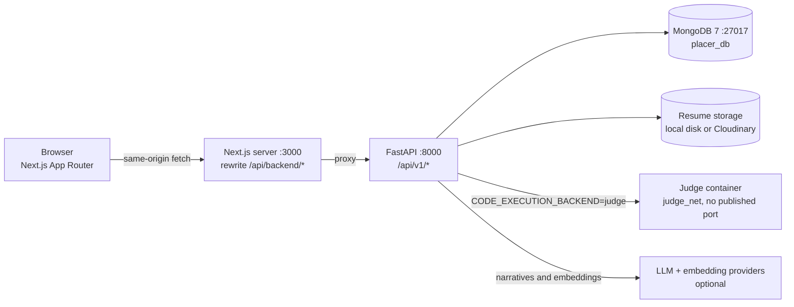

The Next.js rewrite keeps the browser same-origin, so the httpOnly refresh
cookie is same-site and normal traffic does not need CORS. The backend still
configures CORS for direct access and tooling.

**Layers inside the backend**

| Layer | Responsibility |
|---|---|
| `routers/` | HTTP boundary, Pydantic validation, auth guards |
| `services/` | Business rules, aggregation, orchestration |
| `repositories/` | MongoDB access, one class per collection |
| `ml/` | Parsing/OCR, matching, LLM client, RAG store, quality |
| `core/` | Config, database/indexes, security, deps, rate limiter, request IDs |

---

## 3. Request lifecycle and auth

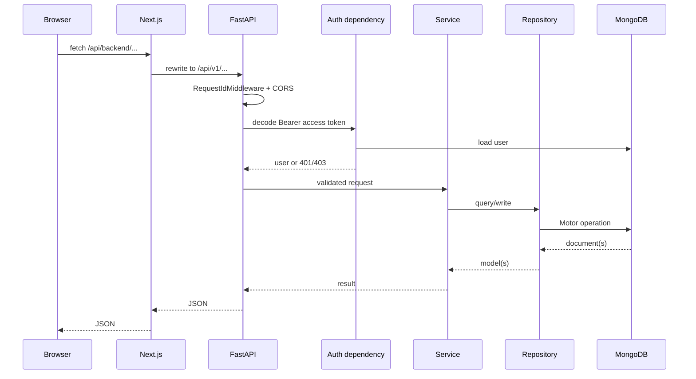

1. `lib/api-client.ts` reads the access token from memory and sends
   `Authorization: Bearer …`.
2. `next.config.mjs` rewrites `/api/backend/:path*` to
   `${NEXT_PUBLIC_API_URL}/api/v1/:path*`.
3. `RequestIdMiddleware` reads/mints `X-Request-ID` and logs one access line.
4. `get_current_user` decodes the JWT and loads the user; `require_role(...)`
   enforces the role (`401` unauthenticated, `403` wrong role).
5. The router validates input and calls a service; the service calls
   repositories and/or ML components.
6. On `401`, the client calls `/auth/refresh` once and retries. On failure the
   page guard redirects to `/login`.

**Token model**

- Access JWT: 15 minutes by default, memory only (never localStorage).
- Refresh token: opaque, httpOnly, SameSite=Lax cookie, 7 days, rotated on every
  use; replaying an old token fails.
- Google Sign-In verifies a client-side ID token and creates/links a user with
  `auth_provider="google"`.

**Identity rule:** `users._id` is the auth identity. Operational records
(`resumes`, `applications`, `assessment_attempts`, `knowledge_states`) use the
**profile** `_id` (`students._id`, `tpos._id`, `admins._id`). Services resolve
through `StudentRepository.get_by_user_id()` and equivalents. Mixing the two is
the most common source of “not found” bugs.

---

## 4. Student onboarding and resume flow

### 4.1 Upload and parse

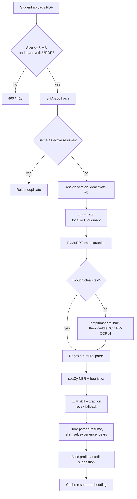

Key behaviour:

- Parsing is **synchronous** during upload (no background queue).
- At most one active resume per student; old versions are kept for history.
- OCR is triggered by `OCR_TRIGGER_MIN_CHARS` (50) or
  `OCR_MIN_ALPHANUMERIC_RATIO` (0.5); disable with `OCR_ENABLED=false`.
- The LLM extractor uses a constrained vocabulary. Unknown phrases go to
  `unmapped_skill_suggestions`; if the LLM fails, regex skills are returned.
- `POST /resumes/{id}/autofill-apply` persists the accepted suggestion. It only
  fills empty/derived fields, so the student stays in control.
- `POST /resumes/{id}/reparse` reruns parsing and recomputes the embedding.

### 4.2 Matching

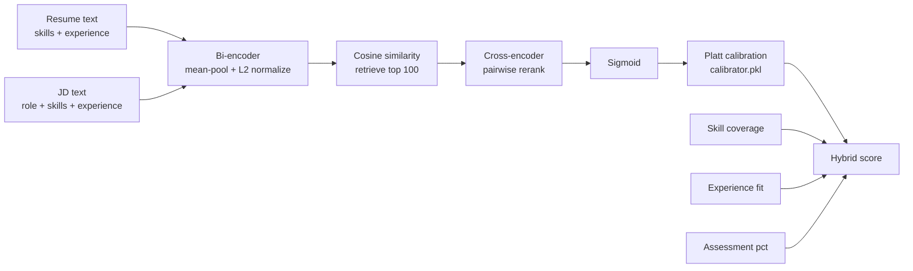

```text
skills_score     = |resume_skills ∩ jd_required_skills| / max(1, |jd_required_skills|)
experience_score = clamp(resume_years / jd_years, 0, 1)      # 1.0 if jd_years = 0
assessment_term  = assessment_pct / 100                       # 1.0 if not required/unscored
final_score      = 0.40·semantic + 0.30·skills + 0.20·experience + 0.10·assessment
```

- `resumes.resume_embedding` and `placement_drives.jd_embedding` are cached.
  Drive edits that change the JD invalidate the JD embedding; reparse
  recomputes the resume embedding.
- Missing model weights → match endpoints return `503`; the rest of the app
  keeps working.
- The same score powers student drive cards, TPO ranked applicants, screening,
  and explanations.

---

## 5. Drives, applications, and screening

### 5.1 Drive lifecycle

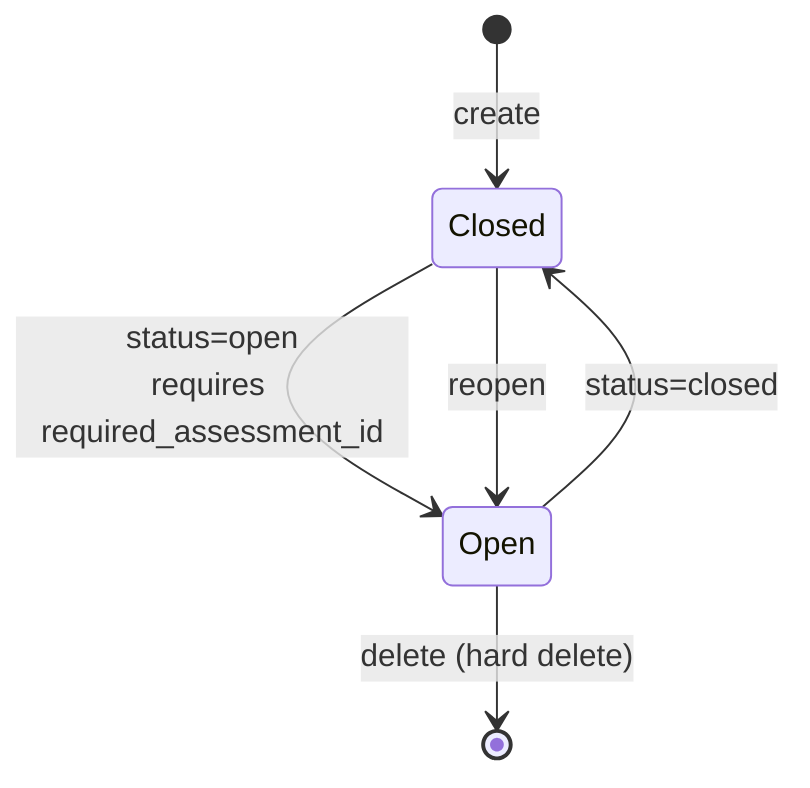

- `DriveStatus` has only `open` and `closed`; “publish” means `status=open`.
- Opening requires a linked assessment. Removing it from an open drive is
  blocked with `ASSESSMENT_REQUIRED_FOR_PUBLISH`.
- Deleting a drive is a hard delete; applications are not cascade-deleted and
  are filtered by the missing drive in read paths.
- A drive stores its JD (`jd_text`), canonical `required_skills`, experience,
  eligibility, deadline, selection stages, and assessment linkage.

### 5.2 Eligibility and application

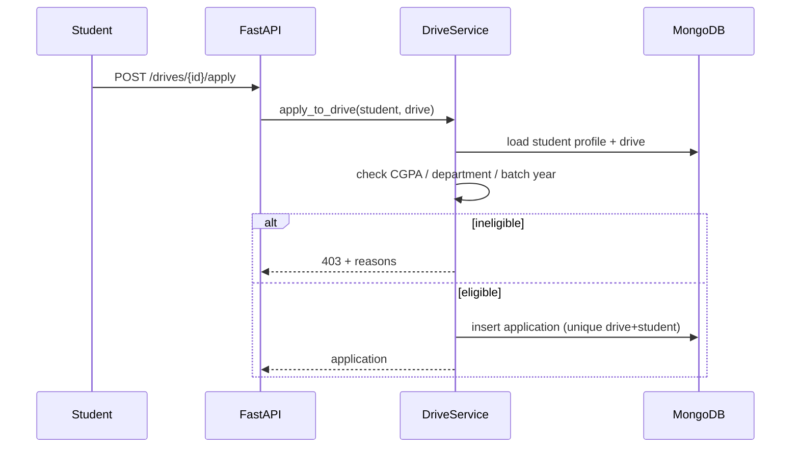

- Eligibility: `min_cgpa` (nullable), `departments` (empty = all), `batch_years`
  (empty = all). Department comparison uses canonical labels on both sides.
- One application per `(drive_id, student_id)`.
- Canonical statuses: `applied`, `shortlisted`, `rejected`. Legacy `selected`
  is mapped to `shortlisted` at read time; no current code writes it.

### 5.3 Screening and shortlisting

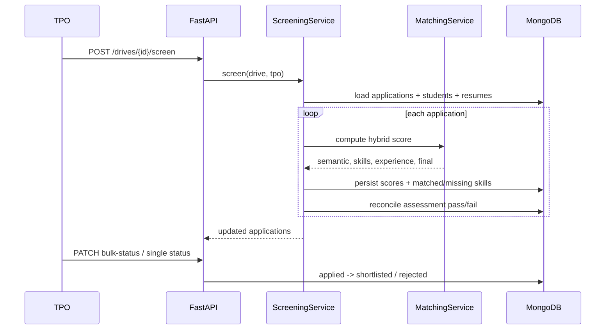

- Screening never changes shortlist/reject status automatically.
- `screening-summary` counts applicants and recommends a shortlist when the
  student is eligible, the assessment is passed/not required, and
  `final_score >= 0.65`.
- `recommended-shortlist` returns the top N with a default `min_score=0.60`.
- CSV export and bulk status updates are available from the drive applicants
  page.

---

## 6. Assessments, grading, and the judge

### 6.1 Creation paths

| Path | Who | Endpoint | Result |
|---|---|---|---|
| Adaptive practice paper | Admin | `POST /assessments` | `adaptive` |
| Standardized drive paper | Admin | `POST /assessments/placement/generate` | `standardized` |
| Template-derived | Admin | `/assessments/templates/*` then placement generation | `standardized` |

Standardized papers use five sections (Quantitative Aptitude, Logical
Reasoning, Verbal Ability, Technical Knowledge, Coding/Problem Solving),
20 questions, a 6/10/4 easy/medium/hard quota, and 1/3/5 marks per difficulty.
Generation is deterministic and returns `422` with explicit deficits instead of
inventing questions.

### 6.2 Attempt lifecycle

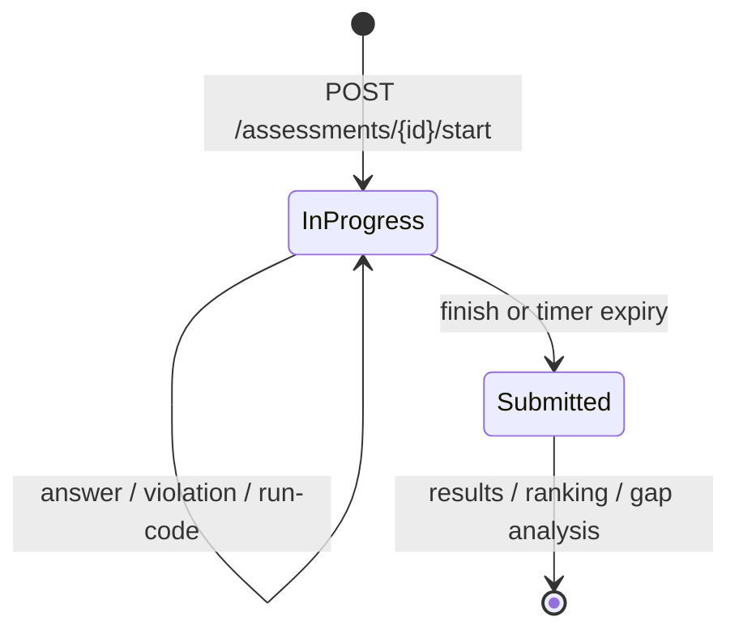

1. **Start** validates that the assessment exists, is published (standardized),
   and the retake policy allows it. Creates an attempt with a session token.
2. **Delivery** is one question at a time. Answers are persisted per question;
   violations are appended.
3. **Finish** grades every answer, updates `knowledge_states`, and sets
   `status=submitted`.
4. **Results** returns the per-question breakdown.

### 6.3 Grading rules

| Type | Rule |
|---|---|
| MCQ / true-false | Exact match against `correct_answer` |
| Multiple-select | All-or-nothing against the correct set |
| Coding | All test cases must pass (visible + hidden) |
| Descriptive | Stored ungraded; manual/API review only |

- Negative marking applies only to standardized assessments and only to wrong
  auto-gradable answers.
- Attempt finalization: standardized papers use `assessment.total_marks` as the
  denominator and clamp earned marks to `[0, total_marks]`; adaptive papers use
  the marks of the questions actually asked. Analytics/ranking use an
  answered-only denominator (Formulas F-2.3), while the results view clamps to
  the paper maximum.
- Adaptive papers store a best-case `total_marks` ceiling at creation.

### 6.4 Coding execution

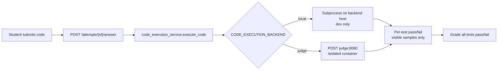

- `execute_code(language, code, test_cases, only_visible=False)` is the only
  public interface.
- The judge container is read-only, non-root, drops all capabilities, and is
  limited to 1 CPU / 256 MB / 128 PIDs with a 64 MB `/tmp` tmpfs.
- The judge sees hidden tests to grade them, but only returns
  input/expected/actual for visible samples.
- Reference solutions are executed at seed time to produce expected outputs and
  are never stored in MongoDB.
- `run-code` lets students try visible samples without submitting.

### 6.5 Anti-cheat

- Per-attempt session token and server-side timer with auto-submit.
- MCQ options randomized per delivery; grading uses option values.
- Violation events: fullscreen exit, tab switch, clipboard, DevTools.
- A configurable threshold triggers auto-submission.
- IP and fingerprint are stored for audit but not continuously compared.
- Fullscreen enforcement is client-side, not a backend guarantee.

---

## 7. Analytics, market, skill gaps, and insights

### 7.1 Analytics data flow

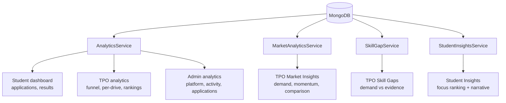

**Student**
- Dashboard: application status counts, upcoming drives, assessment summary.
- Applications: status pipeline per drive.
- Results: per-question score breakdown, mastery, descriptive review state.
- Insights: weak/strong skills, focus ranking, narrative.
- Gap analysis: per-attempt skill gaps (**API-only; no page calls it**).

**TPO**
- Application funnel and status breakdown for owned drives.
- Per-drive breakdown: rankings, applied students, test participants.
- Department/company views, participation counts, assessment ranking.
- Market Insights: demand by skill, trending/declining momentum, filters,
  comparison, import-run provenance.
- Skill Gaps: market demand vs assessment-demonstrated and self-reported
  evidence, with a transparent priority score.

**Admin**
- Platform, attempt, and mastery analytics (placement fields remain legacy and
  are not shown as a placement metric).
- Aggregated activity summary (there is no activity-log viewer page).
- Cross-drive applications records/analytics.
- LLM/embedding observability.
- RAG knowledge ingest/delete/stats (API).

### 7.2 Market data

- `scripts/seed_job_market.py` creates 300 deterministic demo postings and the
  skill catalog.
- `scripts/import_job_market.py` imports public postings (RemoteOK, Arbeitnow,
  Hacker News) and records a `market_import_runs` row.
- Imports are idempotent by source URL.
- The Market Insights banner describes the dataset provenance; provenance is
  otherwise an internal audit field, not a user-facing “demo” label.
- Year-over-year growth compares the latest two **complete** calendar years
  when the newest year is in progress, and states that basis in
  `yoy_growth_basis`.

### 7.3 Skill gaps

- Demand comes from the market postings.
- Assessment-demonstrated evidence comes only from submitted attempts on
  assessments linked to a drive (`required_assessment_id`), not from
  `knowledge_states` (which also includes practice).
- Self-reported evidence comes from the student profile and active resume.
- A minimum number of graded answers is required before classifying a skill as
  demonstrated/developing; insufficient evidence is never treated as
  proficiency.
- Priority combines demand, gap, and growth; weights are exposed in response
  metadata.

---

## 8. LLM and RAG flow

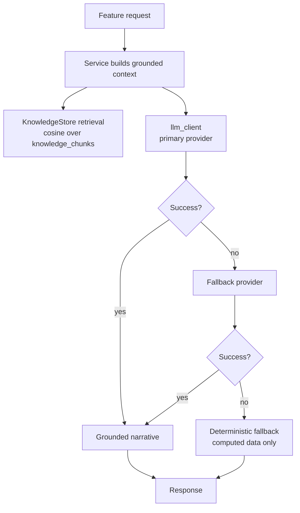

Grounded services:

| Service | Endpoint | Inputs |
|---|---|---|
| `ApplicationExplanationService` | `GET /applications/{id}/explanation` | eligibility, match breakdown, assessment, decision reasons, retrieved chunks |
| `JDExplanationService` | `GET /drives/{id}/match-explanation` | computed match score + JD |
| `StudentInsightsService` | `GET /insights/me` | attempts, mastery, focus ranking |
| `GapAnalysisService` | `GET /assessments/attempts/{id}/gap-analysis` | per-skill correct/answered counts |

Rules:

- Prompts forbid inventing scores or criteria; the LLM narrates computed values.
- Retrieval or LLM failure degrades to deterministic data, never a fabricated
  narrative.
- The client retries only transient failures (`429`, `5xx`, connection,
  timeout) with exponential backoff; `4xx` fails immediately.
- Metrics are exposed at `GET /admin/observability/llm`.
- Thinking mode is selected per call site and translated to the provider’s
  expected parameter.

---

## 9. Data stores and identity

24 collections in `placer_db`:

```text
users 1──1 students | tpos | admins          (by user_id)
students 1──* resumes                         (by student profile _id)
students 1──* applications                    (by student profile _id)
placement_drives 1──* applications             (by drive_id)
placement_drives *──1 companies                (by company_id)
assessments 1──* assessment_attempts           (by assessment_id)
students 1──* knowledge_states                 (by student_id, skill_tag)
```

| Group | Collections |
|---|---|
| Identity | `users`, `refresh_tokens`, `password_reset_tokens`, `students`, `tpos`, `admins` |
| Resume | `resumes` |
| Drives | `placement_drives`, `companies`, `applications` |
| Questions | `question_categories`, `questions` |
| Assessments | `assessments`, `assessment_templates`, `assessment_attempts`, `knowledge_states` |
| Ops / AI | `activity_logs`, `notifications` (unused), `unmapped_skill_suggestions`, `knowledge_chunks`, `insights_narrative_cache` |
| Market | `job_market_postings`, `market_skill_catalog`, `market_import_runs` |

Startup `ensure_indexes()` creates indexes idempotently. Some newer collections
lack explicit startup indexes/TTLs (known gap). Seeded documents carry
`data_origin`, `is_synthetic`, and `synthetic_batch` for internal audit.

---

## 10. End-to-end walkthrough

1. **Admin** seeds/creates the question bank, categories, templates, and
   standardized drive assessments.
2. **TPO** creates a drive with JD, required skills, eligibility, deadline, and
   a required assessment, then opens it.
3. **Student** registers/logs in, completes the profile, uploads a resume, and
   accepts the autofill suggestion.
4. Resume parsing extracts skills and experience; the resume embedding is
   cached.
5. Student browses drives; the backend checks eligibility and computes the
   hybrid match score with matched/missing skills.
6. Student applies. The application is stored with the eligibility result and
   match breakdown.
7. TPO screens applicants: scores are recomputed, assessment outcomes
   reconciled, and a recommended shortlist is produced.
8. Student takes the drive assessment; answers are graded (coding through the
   judge), and mastery is updated.
9. TPO reviews results, shortlists/rejects, and monitors analytics, market
   demand, and skill gaps.
10. Student reviews results and insights; per-attempt gap analysis remains
    API-only. LLM narratives explain the outcome using computed data and
    retrieved knowledge.

---

## 11. Failure and degradation matrix

| Dependency | Failure behaviour |
|---|---|
| MongoDB | Startup fails fast; runtime errors return a generic `500` without stack traces |
| Matching model weights | Match endpoints return `503`; other features work |
| LLM provider | Deterministic fallback data/narrative; hosted calls retry transient errors only |
| Embeddings/RAG | Retrieval degrades; grounded data still returned |
| Judge | `503` when disabled, unreachable, or overloaded |
| OCR | Disabled by flag; digital text still parses |
| spaCy model | Warning + heuristic fallback; app does not crash |
| Cloudinary | Only relevant when `STORAGE_BACKEND=cloudinary`; local disk is the default |

---

## 12. Where to go next

| Question | Document |
|---|---|
| How do I run it? | [`../README.md`](../README.md) |
| What does each page call? | [`PLACER_SYSTEM_DESIGN_AND_DATA_FLOW.md`](./PLACER_SYSTEM_DESIGN_AND_DATA_FLOW.md) §3–§5 |
| What is the exact API? | Design doc §11 |
| How is a number computed? | [`PLACER_MATHEMATICAL_FORMULAS_AND_ALGORITHMS.md`](./PLACER_MATHEMATICAL_FORMULAS_AND_ALGORITHMS.md) |
| What data is seeded? | [`SEED_DATA.md`](./SEED_DATA.md) |
| How does the judge work? | [`CODE_EXECUTION_JUDGE.md`](./CODE_EXECUTION_JUDGE.md) |
| What is still missing? | Design doc §16 |
| What was built when? | [`../PROJECT_PROGRESS.md`](../PROJECT_PROGRESS.md) |
